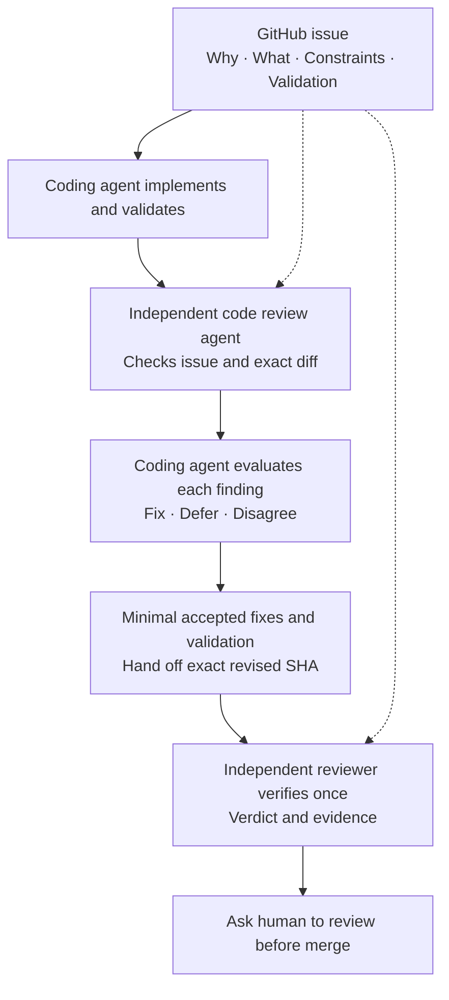

# Issue-driven implementation and review

Both agents open the issue directly. Give the first reviewer only the issue URL and the PR or exact base/head refs so it can form its own assessment. On re-review, include the finding decisions and revised SHA. If the coding agent makes no edits, send the same SHA with its reasoning.

| Finding | Meaning |
| --- | --- |
| **Must fix** | A material correctness, scope, required-validation, or release blocker. An unresolved finding goes to the human as a blocker or explicit decision. |
| **Should fix** | An evidenced issue worth addressing when a small fix fits the scope. |
| **Good to fix** | A small optional improvement with low impact. |
| **Future** | Follow-up work that belongs outside the issue. |

Every finding names the affected requirement or behavior, cites file and line, and gives observed evidence or a reproducible check. The coding agent records **Fix**, **Defer**, or **Disagree** with a reason for each finding. Apply the smallest safe change to accepted findings and rerun affected checks.

The second review reports resolved findings, deferrals, blockers, validation results, and the exact reviewed SHA. It returns **READY**, **CHANGES REQUESTED**, or **BLOCKED**, then asks the human to review. One re-review ends the loop. The human owns merge.

## Run the workflow in Codex

Open a trusted checkout. Start the coding task with `Use coding_agent to implement issue <URL> from <base>.` Start a fresh reviewer context with `Use code_review_agent to review issue <URL> at <PR or exact base/head>.` Use the same profile in a fresh context for the revised SHA if the first reviewer session is unavailable. These profiles define the handoff and expected output. Run each step from Codex.

See [Codex custom agents](https://learn.chatgpt.com/docs/agent-configuration/subagents) for project-scoped agent configuration.
