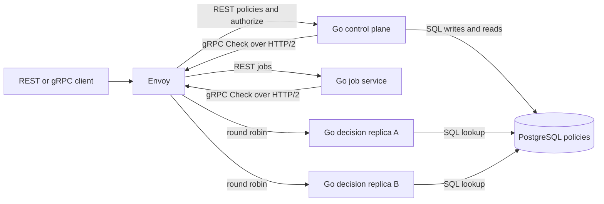
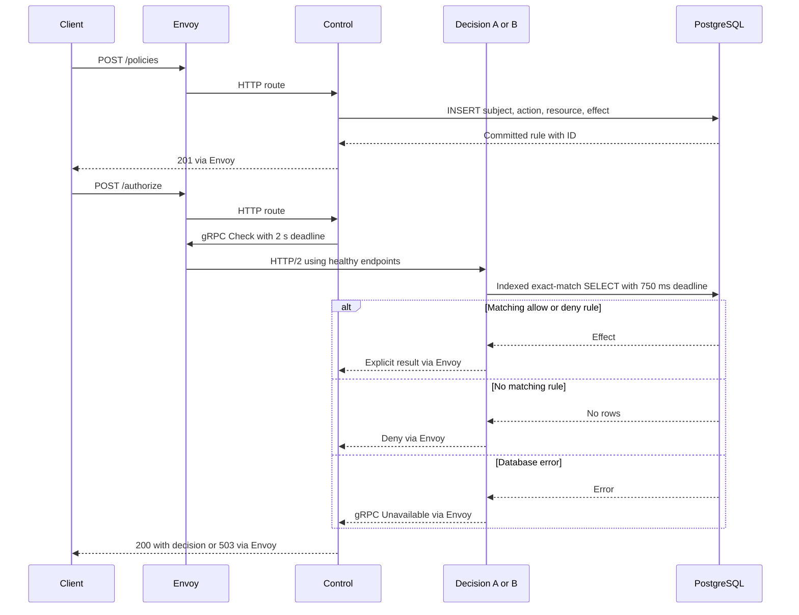
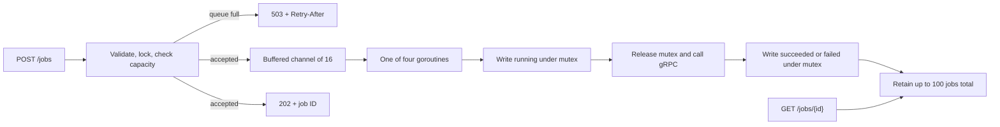

# Architecture

## High-level view

Envoy exposes three loopback ports on the host. The REST listener on 8080 routes policy and job traffic. The gRPC listener on 9090 routes the typed `Check` call to two identical decision replicas. The admin listener on 9901 exposes cluster and Prometheus-format stats for the lab.

## Low-level request sequence

The submitter holds the mutex through admission and insertion into the status map. A worker that receives the job can only publish `running` after that insertion. Workers hold the mutex for state transitions and release it before network I/O. When the history limit is reached, the next accepted job evicts the oldest completed job. Shutdown stops HTTP admission, closes the channel under the same mutex, and waits for workers to drain. A denied decision still represents a successful job because gRPC returned a decision.

## Design decisions

| Decision | Reason and tradeoff |
| --- | --- |
| Exact-match rules, with one row per subject/action/resource | The SQL uniqueness constraint gives the same lookup semantics across replicas and reports conflicts clearly. Wildcards, groups, and policy precedence would change the data model. |
| Default deny with explicit dependency errors | An absent row yields a normal deny. Store outages yield gRPC `Unavailable`, REST `503`, or a failed job so clients can distinguish dependency failure from a policy result. |
| Shared PostgreSQL with per-process connection pools | A committed change is visible on the next decision query. This keeps the learning lab focused on request flow. It couples both planes to database availability and adds a DB round trip to every check. The lab uses the same development DB identity for both planes. |
| Read-only gRPC retry | The gRPC route permits one retry on configured transport failures or an eligible gRPC status. The 850 ms attempt timeout and 1.8 s route timeout fit inside the 2 s client deadline. Envoy retries gRPC statuses in response headers. REST writes and job submission have no configured retry. |
| Active probes and bounded requests | Envoy uses HTTP probes for control and jobs and gRPC health for each decision replica. The decision probe reports process readiness after startup, and individual checks can still fail if PostgreSQL goes down. The decision cluster disables panic routing and bounds connections, pending requests, in-flight requests, and concurrent retries. |
| Bounded process-local job state | Four workers limit concurrency, a 16-entry queue absorbs short bursts, and a 100-job history caps retained state. Job records are transient. Restart clears the queue and job IDs. |
| Local plaintext | Compose uses loopback publishing, local database credentials, and plaintext HTTP/2. The caller supplies the subject for the learning exercise. Client authentication, TLS/mTLS, and independent database roles are production concerns. TLS/mTLS is tracked in [issue #6](https://github.com/radwara/auth-go-envoy-labs/issues/6). |

See the [Envoy router documentation](https://www.envoyproxy.io/docs/envoy/latest/configuration/http/http_filters/router_filter) for retry conditions and response-header behavior.
