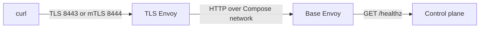

# TLS and mTLS exercise

First run `make up` to start the base lab. Then run `make smoke-tls` with Docker Compose, Bash, OpenSSL, and curl. The exercise starts a second Envoy instance with two loopback listeners and forwards HTTPS requests to the base Envoy REST listener over the Compose network.

| Host port | Server identity | Client identity |
| --- | --- | --- |
| `127.0.0.1:8443` | curl verifies the local CA and the server IP SAN. | No client certificate required. |
| `127.0.0.1:8444` | curl verifies the same server identity. | Envoy requires a client certificate signed by the local CA. |

The test confirms successful TLS and mTLS calls, then checks three handshake failures using the wrong server CA, no client certificate, and a client certificate signed by a different CA. Positive requests go through the base listener to the control-plane readiness endpoint. The mTLS listener checks certificate trust. Application policy still evaluates the subject supplied by the caller on decision requests.

The script creates short-lived local certificates in a temporary ignored directory with private permissions and removes the directory and TLS proxy when it exits. Use the generated CA only within the exercise. TLS terminates at the optional proxy, and service-to-service gRPC continues to use the plaintext transport configured by the base lab.

